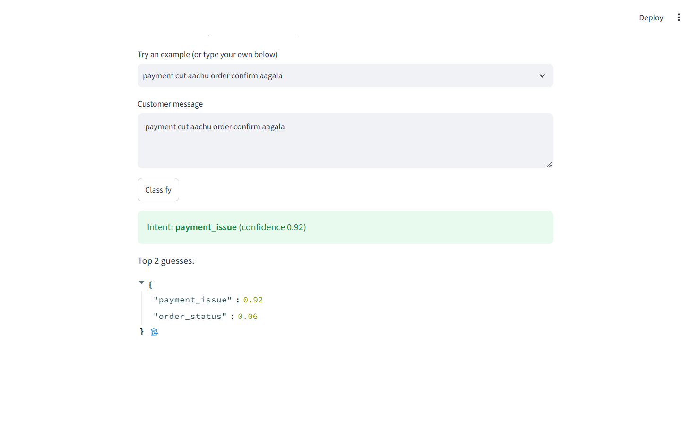
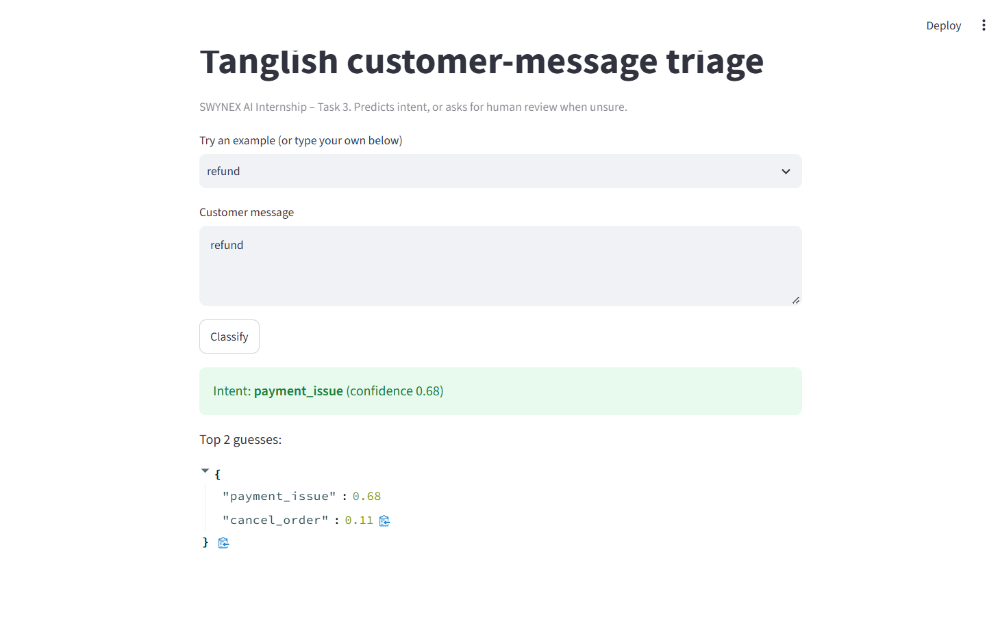
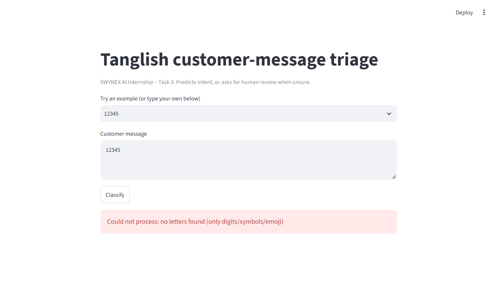

# SWYNEX-Final-AI-Application

**Tanglish Customer-Message Triage: a beginner-friendly AI application**
SWYNEX Technologies AI Internship, Task 4 (Final AI Application)
Intern: Kaushik M | Intern ID: SWX-2026-001365

This is the final project of the internship. It combines the earlier tasks (problem design, model integration, intelligent feature) into one documented, runnable application.

---

## 1. The problem (in plain English)

A small online shop gets dozens of WhatsApp messages a day. Many customers write in **Tanglish**: Tamil words typed in English letters, mixed with English, for example:

> "payment cut aachu but order confirm aagala" (money was deducted but the order was not confirmed)

The shop owner has to read every message to find out what the customer wants, and urgent ones (payment problems, complaints) get buried.

**What this app does:** it reads one message and says which of 6 groups it belongs to, so urgent messages can be handled first.

| Intent | Meaning | Example |
|---|---|---|
| `order_status` | Where is my order? | "anna ennoda parcel ippo enga irukku" |
| `cancel_order` | Cancel my order | "order cancel pannunga please" |
| `payment_issue` | Money / refund trouble | "refund venum payment two times cut aachu" |
| `product_query` | Question about a product | "indha shirt L size irukka" |
| `complaint` | Unhappy customer | "romba mosam service" |
| `other` | Greetings, thanks | "sari nandri" |

**Success criteria set at the start (Task 1):** macro-F1 of at least 0.80, with every message that the app is unsure about handed to a human. (Macro-F1 is an accuracy score that treats all 6 groups equally.)

## 2. How it works (the method)

Think of a **spelling-pattern detective**. Instead of understanding Tamil, it learns which short letter patterns (like "cut a", "cancel", "refun") tend to appear in each group. Because it looks at letter patterns and not whole words, it copes with spelling differences such as "irukku" and "iruku".

Technical name, for reference: TF-IDF character n-grams (2 to 4 letters) + logistic regression, built with the scikit-learn library.

The app then adds three safety layers:

1. **Input check.** Empty text, numbers only, emoji only, or very long text is rejected with a clear message. The app never crashes.
2. **Confidence gate.** The model gives a confidence score. If it is below **0.40**, the app does not guess. It says "needs human review" instead.
3. **Error guard.** Any unexpected failure is caught and reported as an error.

The 0.40 threshold was chosen using cross-validation on the training data only, never by looking at the test set.

## 3. Demo

Run the web demo (steps in section 7), then try these messages.

| Screenshot | What it shows |
|---|---|
|  | A clear message is classified as `payment_issue` (confidence 0.92). |
|  | A short, vague message ("refund") is still answered, with lower confidence (0.68). |
|  | Input with no letters ("12345") is rejected with a clear reason. |

Result format used inside the code:
`{"status": "ok" | "needs_human_review" | "invalid_input" | "error", "label": ..., "confidence": ..., "top2": ..., "reason": ...}`

## 4. Results (real runs, reproducible)

Data: `data/messages.csv`, **134 synthetic messages** (21 to 25 per intent). They were drafted with AI assistance and reviewed by the author. They are **not** real customer chats.

| Measure | Result |
|---|---|
| Repeated 5-fold cross-validation, macro-F1 (all 134 messages) | **0.84** (std 0.08, worst fold 0.70) |
| Held-out test set (34 messages), always-answer accuracy | 0.97, with 1 miss ("i want to cancel and get refund" was labelled `payment_issue`) |
| Held-out test with the confidence gate | 28 of 34 answered automatically (82%), **all 28 correct**; 6 sent to a human |
| 13 hand-made hard cases | 11 correct, 2 deferred to a human, 0 wrong |

How to read this honestly:
- The 34-message test set is tiny, so 0.97 is noisy. The cross-validation figure (0.84) is the more trustworthy one. It meets the 0.80 goal but with a wide spread.
- All the messages come from one author with similar phrasing, so accuracy on real customers will probably be lower.
- The hard cases were written after the system was designed, and for ambiguous or mixed-intent messages any plausible label was accepted. They are a sanity check, not a benchmark.

Trade-off from the training-set run: a higher threshold makes the answered messages more accurate but sends more to a human (threshold 0.40: 61% answered, 92% accurate; threshold 0.55: 42% answered, 100% accurate).

## 5. Limitations

- **Small, synthetic, single-author data.** The biggest weakness. Real messages will be messier.
- **One label per message.** "Cancel my order but also refund me" mixes two intents and only one is returned.
- **Language coverage.** Tamil written in Tamil script (for example "என் ஆர்டர் எங்கே") and formal English were not in the training data, so the app sends them to a human instead of answering.
- **Spelling and dialect.** It is tuned to one style of Tanglish. Other regional styles may confuse it.
- **No learning after deployment.** It does not improve from corrections unless someone retrains it.
- **Not tested on real shop traffic.** All numbers above are from the synthetic dataset.

## 6. Ethics and responsible-use notes

- **Privacy.** No real customer messages, names, phone numbers or order IDs are in the data or the repository. If a shop used this on real chats, it should get customer consent, store as little as possible, and follow India's data-protection rules.
- **Human in the loop.** The app only sorts messages. It never replies, refunds, or cancels anything by itself. Unsure messages go to a person. Complaints and payment problems should always be checked by a human before any action.
- **Fairness and language bias.** The model works best on the exact Tanglish style it was trained on. Customers who write in Tamil script, in another dialect, or in formal English may get "needs human review" more often, which means slower service for them. Anyone deploying this should collect more varied data and measure results per group.
- **Overconfidence.** A confidence score is not a guarantee. Even answered messages can be wrong (one test message was).
- **Not for high-stakes decisions.** Do not use it for legal, medical or financial decisions, or to rank or penalise customers.
- **Transparency.** Customers should be told when an automated tool helps sort their messages.
- **Data origin.** The dataset is synthetic and was drafted with AI assistance, which is stated openly here.

## 7. Run it yourself (beginner steps)

You need Python installed.

1. Download or clone this repository and open a terminal **inside the project folder**.
2. Install the libraries: `python -m pip install -r requirements.txt`
3. Check the evaluation numbers: `python src/evaluate.py`
4. See the hard cases: `python src/hard_cases.py`
5. Run the automated tests: `python -m pytest -q tests`
6. Start the web demo: `python -m streamlit run src/app.py` (it opens at http://localhost:8501)

## 8. Project structure

```
data/messages.csv      134 labelled example messages
data/hard_cases.csv    13 deliberately difficult inputs
data/threshold.json    the chosen confidence threshold (0.40)
src/triage.py          input checks + model + confidence gate
src/evaluate.py        held-out test, cross-validation, threshold selection
src/hard_cases.py      failure-case run
src/app.py             Streamlit web demo
tests/test_triage.py   4 automated tests for error handling
docs/                  demo screenshots
```

## 9. How the internship tasks fit together

| Task | What was done |
|---|---|
| 1. AI Problem Design | Defined the problem, user, data, constraints and success criteria. |
| 2. Model or API Integration | First working classifier (local model; an optional Claude API backend was written but never run). |
| 3. Intelligent Feature | Added input validation, the confidence gate, tests and a web demo. |
| 4. Final AI Application | This repository: everything packaged with results, limitations and ethics notes. |

## 10. What I would do next

1. Collect real, consented, anonymised messages and add Tamil-script and formal-English examples.
2. Allow more than one label per message.
3. Compare against a pretrained language model and report both on the same held-out test set.
4. Measure accuracy separately for different writing styles to check fairness.
